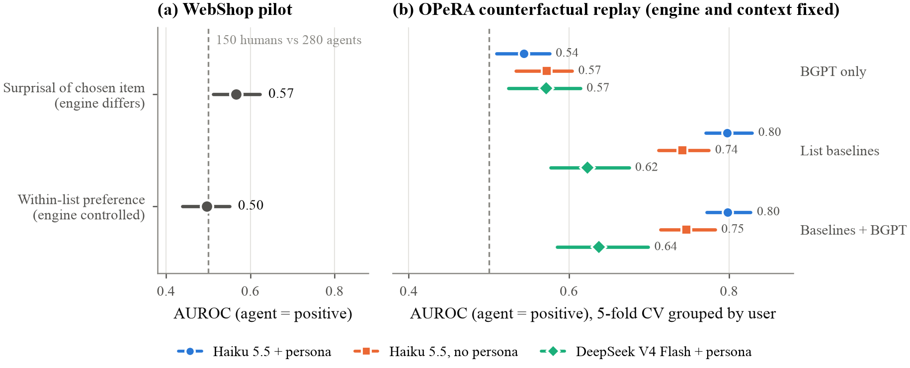
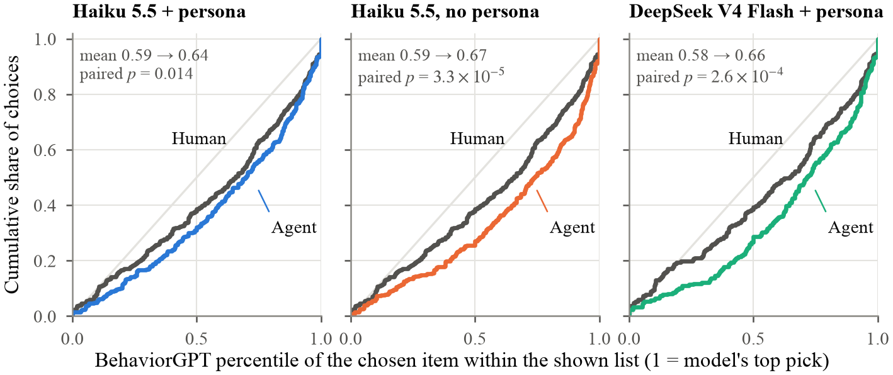
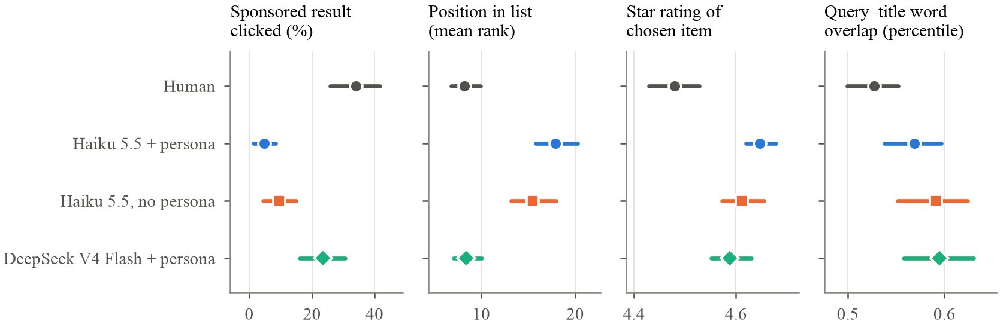
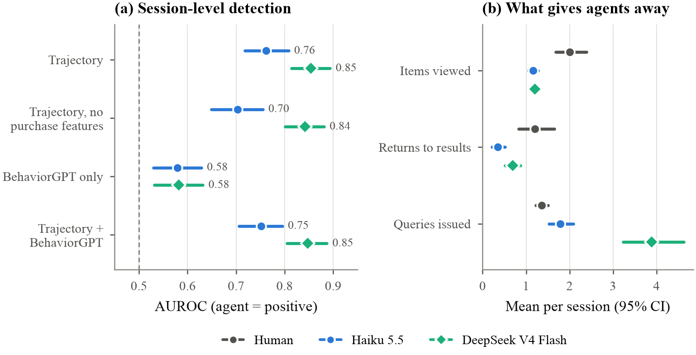

# Too Normal to Be Human

**Can a behavioral foundation model tell LLM agents from the humans they act for?**

We tested BehaviorGPT, Unbox AI's 12.5B-parameter model trained on 150B e-commerce actions, against real LLM shopping agents. The agents are not anomalous. They are *too normal*: the model ranks their choices higher than the human's. The signal is weak, though, and five cheap features of the result list detect agents far better.



## Why it matters

LLM agents now search, compare and buy inside people's accounts, with their history, preferences and payment methods. Platforms need to know when a choice was made by the user or by an agent acting for them. This matters for fraud, account takeover and, in sensitive settings such as government or defense networks, insider-risk monitoring.

Behavioral foundation models look like the natural tool: they assign a likelihood to every next action given a user's history. The vendor's recommended detector is anomaly scoring (surprisal plus CUSUM), which assumes non-human behavior is surprising. We test that assumption.

## What we did

### 1. Pilot on WebShop: we found a confound

- **Data:** 150 human sessions from WebShop, and 300 agent sessions (Claude Haiku 5.5 and DeepSeek V4 Flash) on the same instructions over the same 1.18M products.
- **Naive result:** with the vendor's method, agents look less surprising (AUROC 0.57, paired p ≈ 0.001).
- **Why it is spurious:** the agents' search engine returned lists that were already more aligned with the model. 63% of their top-10 results fall in the model's top 100, against 56% for the humans' engine.
- **Controlled result:** scoring each choice within the list that chooser actually saw, AUROC is 0.50 and the effect disappears.

### 2. Counterfactual replay on OPeRA: our protocol

OPeRA logs real users shopping on live Amazon, together with their self-reported personas. We use 384 clicks on result lists from 45 users, with a median of 55 results per list and 13 history events per call.

At every human click, an LLM agent acting for that same user chooses from the **identical list with the identical history** and the user's persona. Engine, query and context are therefore fixed by construction; only the chooser differs. This is also the realistic threat model: a delegated agent operating inside a legitimate account.

BehaviorGPT scores every item in the list with one API call. We then compare the human's choice with the agent's using three statistics:

- the item's percentile within the list;
- a conditional logit;
- the history gain (how much the user's history raises the item's percentile).



## Results

| | Haiku 5.5 + persona | Haiku 5.5, no persona | DeepSeek V4 Flash + persona |
|---|---|---|---|
| Agent picks the same item as the human | 10% | 14% | 19% |
| BehaviorGPT percentile, human → agent | 0.59 → 0.64 (p = 0.014) | 0.59 → 0.67 (p = 3e-5) | 0.58 → 0.66 (p = 3e-4) |
| BehaviorGPT only, step AUROC | 0.54 | 0.57 | 0.57 |
| BehaviorGPT, user-level AUROC | 0.61 | 0.65 | 0.62 |
| Five list features (logistic regression) | **0.80** | **0.74** | **0.62** |
| List features + BehaviorGPT | 0.80 | 0.75 | 0.64 |

The five list features are list position, sponsored flag, price percentile, star rating, and query–title word overlap. AUROCs are cross-validated, grouped by user, with 95% CIs from a user bootstrap; see the paper.

**Findings**

1. **Agents are too normal, not anomalous.** In all three conditions they choose items the model ranks higher than the human's choice. An anomaly detector pointed at agents is aimed the wrong way.
2. **The signal is weak and redundant.** BehaviorGPT adds at most 0.015 AUROC over five features any platform already logs.
3. **The real tells are cheap.** Humans click sponsored results in 34% of steps, Haiku in 5%. Agents prefer higher-rated items and more literal query matches, and Haiku goes deeper into the list.
4. **Persona does not hide the agent.** The model family matters more: DeepSeek is the hardest agent to detect.
5. **Methodological lesson.** Comparing humans and agents across search engines produces convincing but spurious effects. Score choices relative to what each chooser was shown.



### 3. Whole trajectories under the original engine

Single decisions only tell part of the story, so we also compared complete shopping sessions.

- **Engine.** We rebuilt WebShop's original search engine over all 1.18M products. It reproduces the humans' first results page exactly for **99.6%** of 2,364 searches.
- **Agents.** Claude Haiku 5.5 and DeepSeek V4 Flash shopped in the official WebShop environment, with the same actions and the same 150 goals as the humans. That gives 300 complete sessions, each paired with a human session.

| Detector (session-level AUROC) | Haiku 5.5 | DeepSeek V4 Flash |
|---|---|---|
| Trajectory features | **0.76** | **0.85** |
| Same, without purchase features | 0.70 | 0.84 |
| BehaviorGPT only | 0.58 | 0.58 |
| Trajectory + BehaviorGPT | 0.75 | 0.85 |

Every human demo ends in a purchase, so we checked the result with the purchase features removed.

- **Haiku barely compares:** it views 1.2 items per session vs 2.0 for humans, and returns to the results list 0.35 times vs 1.2.
- **DeepSeek over-searches:** 3.9 queries per session vs 1.4.
- **BehaviorGPT adds nothing:** it scores which product is chosen, and what separates the classes is how people navigate. A session also yields a median of only one step it can score.



## BehaviorGPT resources

- **Overview:** https://unboxai.com/behaviorgpt/overview
- **Platform and API keys:** https://portal.unboxai.com/ (API docs at https://portal.unboxai.com/docs/)
- **Python client** (`behaviorgpt`, MIT; used here to upload the catalog): https://github.com/Unbox-AI/behaviorgpt
- **Anomaly-scoring toolkit** (MIT; the vendor method we evaluate): https://github.com/Unbox-AI/behaviorgpt-anomaly

## Paper

NeurIPS-format draft: [`paper/main.pdf`](paper/main.pdf), with LaTeX sources in `paper/`. Every number in the text is regenerated into `paper/numbers.json` by `src/figures.py`.

## Repository

```
src/
  smoke.py           API mechanics checks (determinism, id filter, history effect, timing, throughput)
  parse.py           WebShop human/agent sessions -> unified format
  build_items.py     WebShop 1.18M products -> jsonl + SQLite FTS5 index
  agent_env.py       text WebShop environment + OpenRouter agent (pilot)
  build_catalog.py   build and upload the BehaviorGPT catalog
  score.py           vendor-method scoring (head top-100 + id-filtered tail)
  analyze.py         pilot AUROCs vs baselines
  choice_set.py      engine-controlled within-list statistic (pilot)
  opera_parse.py     OPeRA -> per-user event streams + replayable click steps
  opera_agent.py     counterfactual replay agent (persona, history, identical list)
  opera_catalog.py   add OPeRA products to the catalog
  opera_score.py     one BehaviorGPT call per step, with and without history
  opera_analyze.py   paired tests, AUROCs, grouped-CV detectors
  figures.py         publication figures + paper/numbers.json
  ws_build_docs.py   rebuild WebShop's original search documents (full catalog)
  ws_verify.py       check the rebuilt engine against the humans' result pages
  ws_agent.py        full-trajectory agents in the official WebShop text environment
  ws_convert.py      human and agent trajectories -> one format + trajectory features
  ws_score.py        BehaviorGPT session scoring (vendor method)
  ws_analyze.py      session-level detectors; figures_traj.py makes fig_traj
results/             PILOT.md, OPERA_REPLAY.md and JSON outputs
paper/               LaTeX sources, figures (PDF + PNG), compiled PDF
```

## Reproduce

Requirements: [uv](https://docs.astral.sh/uv/), a BehaviorGPT API key and an OpenRouter key.

1. Set up the environment and the vendored anomaly toolkit, pinned to the commit we used:

   ```bash
   uv sync
   git clone https://github.com/Unbox-AI/behaviorgpt-anomaly vendor/behaviorgpt-anomaly
   git -C vendor/behaviorgpt-anomaly checkout $(cat vendor/ANOMALY_COMMIT)
   ```

2. Create a `.env` file (never commit it) with:

   ```
   UNBOXAI_API_KEY=...
   OPENROUTER_API_KEY=...
   ```

3. Download OPeRA (CC-BY-4.0) into `data/raw/opera/` from https://huggingface.co/datasets/NEU-HAI/OPeRA. Then run the replay pipeline:

   ```bash
   uv run python src/opera_parse.py
   uv run python src/opera_catalog.py
   uv run python src/opera_agent.py --model anthropic/claude-haiku-5.5
   uv run python src/opera_agent.py --model anthropic/claude-haiku-5.5 --no-persona
   uv run python src/opera_agent.py --model deepseek/deepseek-v4-flash
   uv run python src/opera_score.py
   uv run python src/opera_analyze.py
   uv run python src/figures.py
   ```

For the trajectory experiment, clone https://github.com/princeton-nlp/WebShop into `vendor/WebShop`. Then:

- Create a Python 3.10 venv at `vendor/ws-venv` with `pyserini==0.17.0` and the WebShop text-environment dependencies; it needs Java 11.
- Run `src/ws_build_docs.py`.
- Index with `pyserini.index.lucene` using the repo's `run_indexing.sh` settings.
- Run `src/ws_verify.py`, then `src/ws_agent.py` and `src/ws_convert.py`, `ws_score.py`, `ws_analyze.py`.

Cost: under US$10 in LLM calls; the BehaviorGPT API was free during early access.

## Limitations

- Full sessions are tested only on WebShop, where humans follow instructions. Timing is not modelled, and BehaviorGPT ignores time below the hour anyway.
- OPeRA products enter the catalog with title and price only.
- 36% of DeepSeek's answers were invalid.
- 45 users is a small sample for user-level claims.

## Data and ethics

- **Public data only:** WebShop and OPeRA (CC-BY-4.0).
- **No sensitive data:** BehaviorGPT's terms allow the vendor to train on uploaded content, so the hosted model is unsuitable for sensitive (e.g. defense) data regardless of accuracy.
- **Dual use:** detecting delegated agents can protect users, but crude heuristics such as ad avoidance would also block legitimate assistive agents.
